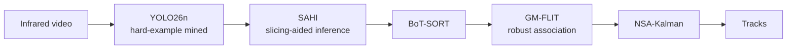
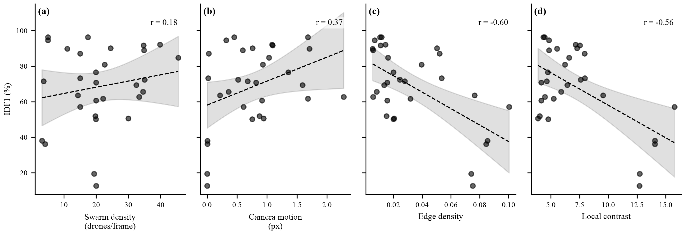
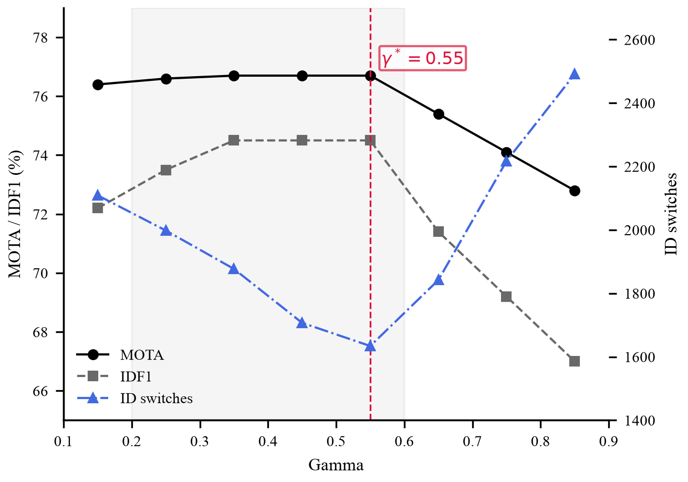
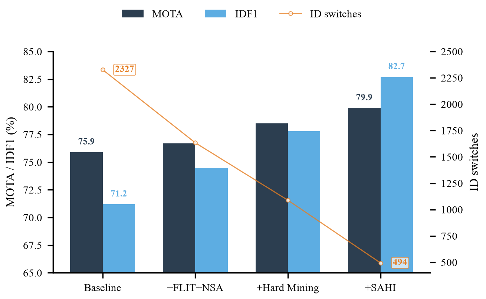

<div align="center">

# Infrared Multi-UAV Tracking

**From Baseline to an Experimentally Optimized Pipeline for Infrared Multi-UAV Tracking**

Ighor de Souza Ribeiro · Rigel Procópio Fernandes · Gabriel de Sapienza Luna

[](LICENSE)
[](requirements.txt)

</div>

---

A systematic, component-wise study of detector, association, and inference choices for multi-object tracking of UAV swarms in infrared video, evaluated on Track 3 of the 4th Anti-UAV Challenge. Rather than proposing a new architecture, this work isolates which design choices actually help — and which don't — under a controlled, incremental protocol on a common benchmark.



## Results

| Configuration | MOTA (%) | IDF1 (%) | ID switches |
|---|:---:|:---:|:---:|
| Baseline (YOLO26n + BoT-SORT) | 75.9 | 71.2 | 2,327 |
| + GM-FLIT + NSA-Kalman | 76.7 | 74.5 | 1,634 |
| **Final (+ hard mining + SAHI)** | **79.9** | **82.7** | **494** |

BoT-SORT was selected after a native comparison against five other trackers (FastTrack, ByteTrack, TrackTrack, OC-SORT, Deep OC-SORT); see `src/inference/run_multitracker_leaderboard.py`.

## Root-cause analysis

Two mechanisms, tested independently, explain most of the identity-switch and missed-detection variance across sequences — swarm density and camera motion were ruled out (both weakly *positively* correlated with MOTA, r = +0.196 and r = +0.224).

<p align="center">
  
</p>

- **Structured background clutter** (edge density) correlates strongly with identity switches (r = −0.60 with IDF1). Static high-contrast structures (windows, building facades) generate persistent false positives indistinguishable from stationary drones.
- **Target-background contrast**, measured per ground-truth box against its immediate surrounding annulus, is an *independent* mechanism driving missed detections (r = 0.71 with MOTA, Mann-Whitney p < 10⁻³⁰⁰, n = 19,123 boxes) — confirming the classic small-target IR literature, but only when contrast is measured at the target rather than as a scene-wide statistic.

## What didn't work

Two families of interventions were tested on top of the baseline and found ineffective — evaluating negative results was itself part of the methodology.

| Preprocessing | ΔMOTA | ΔIDF1 |
|---|:---:|:---:|
| MOG2 background subtraction | −168.7 | −55.2 |
| EMA smoothing | −73.6 | −33.2 |
| Dense optical flow | −53.4 | −44.8 |

All pixel-level preprocessing degraded performance, consistent with detector domain shift (fine-tuned only on raw infrared frames). Six further association/track-level modifications (static track filter, adaptive confidence threshold, lost-query bank, recurrence filters) also failed to beat the GM-FLIT + NSA-Kalman reference — see `src/postprocessing/` and `src/inference/run_*_sweep.py`.

<p align="center">
  
  
</p>

## Setup

```bash
git clone https://github.com/IghorRibeiro/DroneTrackingMOT.git
cd DroneTrackingMOT
python -m venv .venv && source .venv/bin/activate
pip install -r requirements.txt
```

Dataset: Track 3 of the [4th Anti-UAV Challenge](https://zenodo.org/records/15103888) (not included — place under `dataset/` per the paths in `src/inference/common.py`).

## Reproducing

```bash
# Baseline: detector + 6-tracker comparison
python train.py
python src/inference/run_tracker_on_val.py
python src/inference/run_multitracker_leaderboard.py

# Root-cause analysis
python src/analysis/density_correlation.py
python src/analysis/camera_motion_estimation.py
python src/analysis/frame_quality_metrics.py
python src/analysis/target_bg_contrast.py

# Negative results
python src/inference/run_preprocessing_ablation.py
python src/inference/run_static_filter_sweep.py
python src/inference/run_spatial_filter_sweep.py
python src/inference/run_hybrid_filter_sweep.py

# Hard-example mining
python src/inference/run_tracker_on_train.py
python src/inference/select_hard_examples.py
python src/inference/build_hard_dataset.py

# Final pipeline: hard mining + GM-FLIT + NSA-Kalman + SAHI
python src/inference/run_robust_flit_sweep.py
python src/inference/run_sahi_flit_nsa.py --weights weights/best_hardmining.pt

# Figures
python paper_figures/generate_all_figures.py
```

Full component breakdown (detector, association, negative results, root-cause) is organized under `src/{data,inference,postprocessing,preprocessing,analysis}/`.

## Citation

Paper in preparation. Citation details will be added upon acceptance.

## License

Code released under [MIT](LICENSE). Dataset usage follows the [4th Anti-UAV Challenge](https://zenodo.org/records/15103888) terms.
