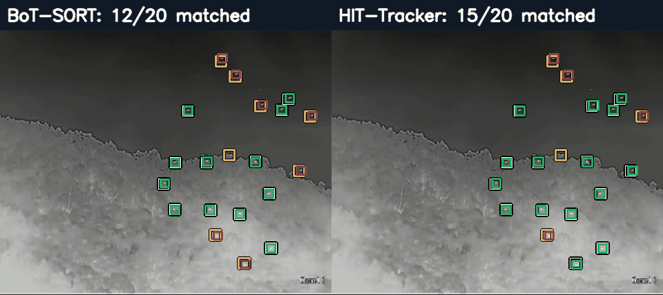
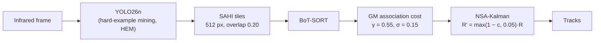
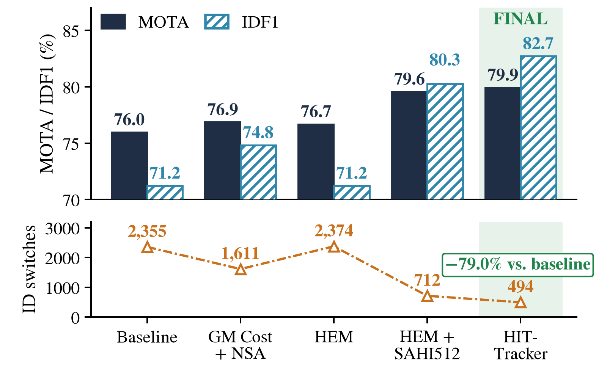
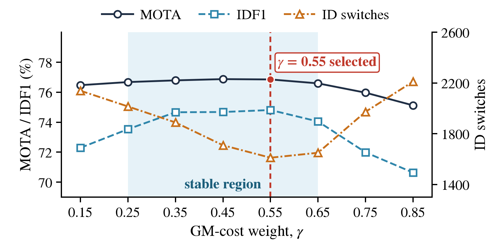
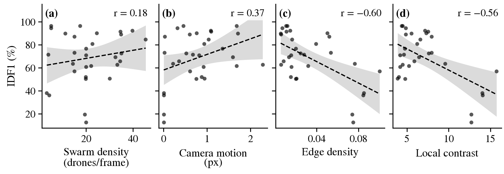
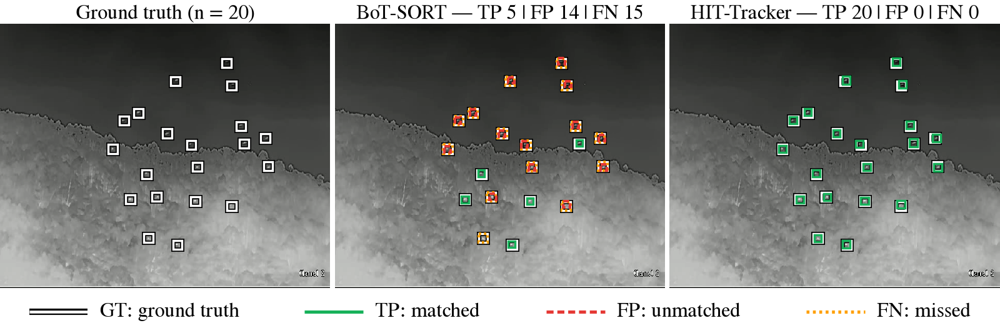

# From Baseline to HIT-Tracker: An Experimentally Optimized Pipeline for Infrared Multi-UAV Tracking

**Ighor de Souza Ribeiro**<sup>1</sup>, **Rigel Procópio Fernandes**<sup>2</sup>, **Gabriel de Sapienza Luna**<sup>3</sup>

<sup>1</sup> Centro de Instrução Almirante Alexandrino (CIAA), Rio de Janeiro, RJ, Brazil  
<sup>2</sup> Diretoria de Sistemas de Armas da Marinha (DSAM), Rio de Janeiro, RJ, Brazil  
<sup>3</sup> Universidade Federal do Rio de Janeiro (UFRJ), Rio de Janeiro, RJ, Brazil

[](#citation)
[-e07a00)](#citation)
[](LICENSE)
[](requirements.txt)

Code and experimental materials of the paper accepted at **LAFusion 2026** (Fourth Latin American Workshop on Information Fusion), to appear in
Springer CCIS.

<p align="center">
  <br>
  <em>BoT-SORT baseline vs. HIT-Tracker on UAV240, frame 309: 5/20 vs. 20/20 drones matched.</em>
</p>

## TL;DR

* HIT-Tracker improves MOTA by **+3.9 p.p.** and IDF1 by **+11.5 p.p.** and reduces identity switches (IDs) by **79.0 %** relative to the BoT-SORT baseline (internal held-out split of the Anti-UAV Track 3 data).
* Detection (hard-example mining + tiled inference) accounts for most of the gain.
* The GM association cost + NSA-Kalman adds identity gains at negligible computational cost.

## Pipeline



* **GM association cost:** `C = (1 − γ)·C_IoU + γ·ρ(l)`, `ρ(l) = l² / (l² + σ²)`, σ = 0.15, γ = 0.55, where `l` is the L2 distance between box centres normalised by the frame diagonal (`src/tracking/gm_cost.py`).
* **NSA-Kalman:** the detection confidence `c` scales the Kalman measurement noise, `R' = max(1 − c, 0.05)·R`; the 0.05 floor prevents a vanishing noise (`src/tracking/nsa_kalman.py`, enforced by the Ultralytics Kalman filter).
* **HEM:** training sequences ranked by tracking score; all frames of the worst ones (3,846 images) are mixed with 5,000 random training images; AdamW, 8 epochs, native resolution (`configs/hem_train.yaml`).
* **SAHI:** 512 px tiles, overlap 0.20, confidence 0.25 (`configs/sahi.yaml`).

*Naming:* the paper calls the cost "GM association cost" and "GM + NSA" the cost combined with NSA-Kalman. Early versions of this code and its git history call the same cost "GM-FLIT" / "FLIT"; the code in this revision uses the paper's names.

## Results

30 held-out sequences, 22,839 frames, 478,548 ground-truth boxes. MOTA and IDF1 in %, IDs = identity switches.
FPS is end-to-end on an Apple M2 (MPS) and **only comparable within one measurement session on one machine**.

| Configuration (Fig. 3) | MOTA | IDF1 | IDs | FPS |
|---|---:|---:|---:|---:|
| Baseline (YOLO26n + BoT-SORT) | 76.0 | 71.2 | 2,355 | 45.05 |
| GM + NSA | 76.9 | 74.8 | 1,611 | |
| HEM | 76.7 | 71.2 | 2,374 | |
| HEM + SAHI512 | 79.6 | 80.3 | 712 | 14.53 |
| **HIT-Tracker** | **79.9** | **82.7** | **494** | 14.48 |

The baseline, HEM + SAHI512 and HIT-Tracker FPS values were measured in the same session; the cost of GM + NSA is negligible and the roughly threefold slowdown stems from tiled inference.

<p align="center">
  <br>
  <em>Fig. 3. Evolution of MOTA, IDF1, and IDs from the baseline to HIT-Tracker.</em>
</p>

**Table 2 — Native tracker comparison, YOLO26n detector, default configurations** (FPS measured in a single session on an Apple M2 with MPS)

| Tracker | MOTA (%) | IDF1 (%) | IDs | FPS |
|---|---:|---:|---:|---:|
| BoT-SORT (adopted) | **76.0** | **71.2** | 2,355 | 45.05 |
| FastTracker | 72.7 | 50.5 | 3,948 | 51.96 |
| ByteTrack | 71.7 | 49.4 | 4,582 | 52.74 |
| OC-SORT | 71.5 | 51.8 | 4,454 | 49.61 |
| Deep OC-SORT | 71.2 | 52.5 | 4,165 | 48.70 |
| TrackTrack | 63.1 | 68.9 | **836** | 43.54 |

**Table 3 — SAHI tile-size sweep on the HEM detector with the default BoT-SORT association** (Rel. FPS = throughput relative to the 512 px tile, measured within the sweep session)

| Tile size (px) | Overlap | MOTA (%) | IDF1 (%) | IDs | Rel. FPS |
|---:|---:|---:|---:|---:|---:|
| 320 | 0.30 | 76.4 | 77.5 | 864 | 0.49 |
| 384 | 0.25 | 77.6 | 79.5 | 642 | 0.65 |
| 448 | 0.20 | 77.9 | 80.8 | 592 | 0.63 |
| **512** | 0.20 | **79.6** | **80.3** | 712 | 1.00 |
| 576 | 0.20 | **79.6** | 79.9 | 718 | 1.02 |

The 512 and 576 px tiles tie in MOTA; 512 px has higher IDF1 and fewer IDs and was selected. Note that the overlap ratio was not constant in the sweep.

<p align="center">
  <br>
  <em>Fig. 2. MOTA, IDF1, and IDs as a function of the GM association cost weighting factor γ.</em>
</p>

MOTA stays within 0.3 p.p. of its maximum for γ ∈ [0.25, 0.65]; IDs reach their minimum at γ = 0.55 (1,611). On unrounded numbers the best MOTA of the sweep is at γ = 0.45 (76.87 vs. 76.85 at γ = 0.55); γ = 0.55 has the best IDF1 and the fewest IDs, which is why it is the operating point.

### Per-sequence consistency

HIT-Tracker improved MOTA in 27 of the 30 sequences and IDF1 in 25, and reduced IDs in 29 (one tie), p < 0.001 for all three (Wilcoxon signed-rank tests across sequences). The gains follow the clutter: across edge-density tertiles, from lowest to highest, ΔIDF1 is +10.8, +9.3 and +16.7 p.p. and ΔMOTA is +2.4, +3.1 and +7.8 p.p. All statistics quoted in the paper are recomputed by `scripts/statistics.sh` (`results/statistics/`).

## Root-cause analysis

<p align="center">
  <br>
  <em>Fig. 1. Correlation between candidate factors and baseline identity preservation (IDF1).</em>
</p>

Structured background clutter, not swarm density or camera motion, explains the baseline's identity errors:

* **Edge density:** r = −0.600 with IDF1 (p < 0.001; Holm-adjusted p = 0.004) and r = −0.348 with MOTA.
* **Swarm density:** r = +0.180 with IDF1 (p = 0.34); **camera motion:** r = +0.368 (p = 0.045, not significant after Holm correction over the eight per-sequence variables).
* **Per-target contrast** (ground-truth box vs. its surrounding annulus): r = +0.707 with MOTA, +0.600 with IDF1 and −0.712 with the FN rate: low target-background contrast is associated with missed detections rather than with identity errors.

## Negative and null results

**Pixel-level preprocessing** (applied before detection; full tracking evaluation, baseline detector):

| Method | MOTA (%) | IDF1 (%) | IDs |
|---|---:|---:|---:|
| Baseline | 76.0 | 71.2 | 2,355 |
| MOG2 | −168.6 | 16.0 | 5,048 |
| EMA | 2.4 | 38.0 | 4,882 |
| Dense optical flow | 22.6 | 25.8 | 5,544 |

Detection-only mAP50 (3,846 hard-example images): 0.547 → 0.529 (−3.3 %) with CLAHE, gamma correction or unsharp masking, and 0.167 (−69.4 %) with sharpening. These detection-only numbers are reported in the paper; **no script for them is included in this repository.**

**Track-level interventions** on top of GM + NSA (γ = 0.55):

| Intervention | MOTA (%) | IDF1 (%) | IDs |
|---|---:|---:|---:|
| GM + NSA (reference) | 76.9 | 74.8 | 1,611 |
| Static track filter | 65.7 | 68.9 | 1,816 |
| Lost-query bank | 76.0 | 72.4 | 3,464 |
| Adaptive confidence threshold | 77.0 | 74.9 | 1,535 |

A kinematic/shape consistency check is a diagnostic, not an intervention: a Mann–Whitney U test on the normalised centroid displacement of 464,345 track transitions (HEM + SAHI512 with default BoT-SORT) did not separate true-positive transitions from identity switches (p = 0.207).

## Protocol

* **Split:** at the *sequence* level; 30 held-out sequences (`configs/splits/heldout_30.txt`), 170 training sequences. The detector is trained on stride-4 frames (32,330 training and 5,724 validation images); tracking is evaluated on **every frame** of the held-out sequences (22,839 frames, 478,548 ground-truth boxes).
* **Fresh tracker per sequence:** each sequence is processed by a newly initialised detector/tracker (reusing one `model.track(..., persist=True)` object across sequences leaks identities between videos).
* **Metrics:** py-motmetrics 1.4.0, IoU matching threshold 0.5; MOTA, IDF1, IDs, FP, FN from summed per-sequence counts.
* **Hardware:** all tracking experiments on an Apple M2 (MPS backend) with Ultralytics 8.4.113; detector fine-tuning (baseline and HEM) on a single NVIDIA Tesla T4.
* **FPS:** end-to-end per sequence (frame decoding, detection including tiling when used, and tracking). FPS is only comparable within the same session on the same machine.
* **Limitations:** internal held-out split (no evaluation server for the hidden test set); configuration selected on the same sequences used for the final evaluation (split-half optimism below 0.7 p.p.); single dataset; a single training run per detector, without seed variation.

## Setup and dataset

```bash
python3.13 -m venv .venv && source .venv/bin/activate
pip install -r requirements.txt
```

Pinned versions: Python 3.13, `ultralytics==8.4.113`, `sahi==0.12.2`, `motmetrics==1.4.0` (see `requirements.txt`; the paper's numbers were produced with numpy 1.26.4, which pip cannot resolve together with pandas 2.3.3 on Python 3.13, so numpy 2.x is pinned; the metrics come from integer counts and do not depend on it).

**Dataset (not redistributed):** 4th Anti-UAV Challenge, Track 3 — [DOI 10.5281/zenodo.15103888](https://doi.org/10.5281/zenodo.15103888). Download it from Zenodo under its own terms and place it as

```
data/MultiUAV_Train/
├── TrainVideos/MultiUAV-<n>.mp4
├── original_label_file/UAV<n>/gt/gt.txt
└── TrainLabels/MultiUAV-<n>.txt
```

The data root is configurable: set `ANTIUAV_ROOT` to your `MultiUAV_Train` directory, or `DRONE_MOT_ROOT` to move all data directories (data, weights, trajectories, outputs) at once.

## Reproducing the paper

Saved trajectories of every experiment are attached to the GitHub Release `v1.0-lafusion2026` (`bash scripts/fetch_assets.sh`). Per-sequence counts of every configuration are in `results/per_sequence/` and totals in `results/summary.csv`.

| Paper item | Command | Expected output |
|---|---|---|
| Everything (fast, from `results/`, no dataset) | `bash scripts/reproduce_all.sh --from-results` | all rows of `results/paper_numbers.csv` match; Figs. 1–3 |
| Everything (from saved trajectories) | `bash scripts/reproduce_all.sh --fast` | `32/32 rows match the paper`; all statistics; Figs. 1–4 |
| Everything (detector + tracker, about 6–7 h on an M2) | `bash scripts/reproduce_all.sh --full` | same as `--fast` |
| Table 2 (trackers) | `bash scripts/table2_trackers.sh [--full]` | 6/6 rows OK |
| Table 3 (SAHI tiles) | `bash scripts/table3_sahi_tiles.sh [--full]` | 5/5 rows OK |
| Fig. 2 (γ sweep data) | `bash scripts/fig2_gamma_sweep.sh [--full]` | 8/8 rows OK |
| Fig. 3 / Section 4.1 (pipeline) | `bash scripts/fig3_pipeline.sh [--full]` | 5/5 rows OK |
| Section 3.6 (preprocessing) | `bash scripts/negative_preprocessing.sh [--full]` | 4/4 rows OK |
| Section 3.6 (interventions) | `bash scripts/negative_interventions.sh [--full]` | 4/4 rows OK |
| FPS (Table 2, Section 4.1) | `bash scripts/fps_benchmark.sh` (single session, about 2 h) | `outputs/fps/fps_summary.csv` |
| Root cause (Section 3.3) | `python -m src.analysis.root_cause` | 12/12 values reproduced |
| Statistics, Mann–Whitney, split-half | `bash scripts/statistics.sh` | `50/50 statistics quoted in the paper reproduced` |
| Detector training (base, HEM) | `bash scripts/train_detectors.sh` | `runs/detect/...` |
| Figs. 1–4 (final print size) | `bash scripts/make_figures.sh` | `figures/fig1.pdf` … `fig4.pdf` and `.png` |
| Hero image, GIF, social card | `python -m src.figures.hero --gif` | `assets/` |

Single experiment: `python -m src.tracking.run_experiment --id hit` (ids in `configs/experiments.yaml`). Evaluate any trajectory directory: `python -m src.evaluation.mot_eval --traj-dir trajectories/hit`.

**Figures.** `figures/fig1.pdf`–`fig4.pdf` are the figures of the paper at final print size (`.png`: 1600 px web versions). Fig. 4 and the hero assets need the original dataset frame, which is not redistributed; without the dataset `make_figures.py` regenerates Figs. 1–3 and skips Fig. 4.

<p align="center">
  <br>
  <em>Fig. 4. Qualitative comparison between the baseline (BoT-SORT) and HIT-Tracker on sequence UAV240, frame 309, showing matched, unmatched, and missed detections. The frame is the top-ranked one of an automatic scan of all ground-truth frames (<code>results/figure_selection/</code>), i.e. a best-case illustration.</em>
</p>

## Model weights

| File | Description | SHA-256 |
|---|---|---|
| `weights/best.pt` | YOLO26n fine-tuned on the training split (baseline detector) | `57d7e51ccf5a9574167bea26ac82898c0f7327929ce112fff43e234cd34be4a2` |
| `weights/best_hardmining.pt` | baseline fine-tuned with hard-example mining (HEM) | `56a11fac9992c0d9f3bd97f2f324951c40c8e7cda9bfbd794d0e0b81c44cceac` |

They are also attached to the GitHub Release. Training hyper-parameters are in `configs/base_train.yaml` and `configs/hem_train.yaml`; the 20 hard sequences and the 5,000 random images of the HEM mixture are listed in `configs/splits/`.

## Repository layout

```
configs/    tracker YAMLs, SAHI, detector training, experiment registry, splits
src/        data, detector, tracking (GM cost, NSA-Kalman, interventions), evaluation, analysis, figures
scripts/    one script per table / figure, reproduce_all.sh
results/    per-sequence counts, summary.csv, paper numbers, FPS logs, statistics, root-cause factors
figures/    fig1–fig4 (PDF + PNG)      assets/    hero image, GIF, social card      weights/    detector checkpoints
```

## Citation

```bibtex
@inproceedings{ribeiro2026hittracker,
  author    = {Ribeiro, Ighor de Souza and Fernandes, Rigel Proc{\'o}pio and Luna, Gabriel de Sapienza},
  title     = {From Baseline to {HIT-Tracker}: An Experimentally Optimized Pipeline for Infrared Multi-{UAV} Tracking},
  booktitle = {Fourth Latin American Workshop on Information Fusion (LAFusion 2026)},
  series    = {Communications in Computer and Information Science},
  publisher = {Springer},
  year      = {2026},
  note      = {To appear},
  pages     = {TBA},
  doi       = {TBA}
}
```

A `CITATION.cff` is provided for GitHub's "Cite this repository" button.

## License and acknowledgements

Distributed under the **GNU Affero General Public License v3.0** (`LICENSE`, `NOTICE`): the GM association cost and NSA-Kalman patches adapt methods of the BoT-SORT/STrack implementation of [Ultralytics](https://github.com/ultralytics/ultralytics), which is AGPL-3.0.

We thank the organisers of the 4th Anti-UAV Challenge for releasing the dataset used in this work.
