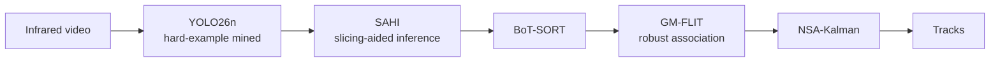

<div align="center">

# Infrared Multi-UAV Tracking

**From Baseline to an Experimentally Optimized Pipeline for Infrared Multi-UAV Tracking**

Ighor de Souza Ribeiro · Rigel Procópio Fernandes · Gabriel de Sapienza Luna

[](LICENSE)
[](requirements.txt)

</div>

---

A tracking-by-detection pipeline for multi-UAV swarms in infrared video, built on YOLO26n + BoT-SORT and evaluated on Track 3 of the 4th Anti-UAV Challenge. A component-wise study identifies structured background clutter — not swarm density or camera motion — as the main driver of identity-switch failures, and combines hard-example mining, a robust association cost (GM-FLIT), confidence-adaptive Kalman filtering (NSA-Kalman), and slicing-aided inference (SAHI) into a single optimized pipeline.



## Results

| Configuration | MOTA (%) | IDF1 (%) | ID switches |
|---|:---:|:---:|:---:|
| Baseline (YOLO26n + BoT-SORT) | 75.9 | 71.2 | 2,327 |
| + GM-FLIT + NSA-Kalman | 76.7 | 74.5 | 1,634 |
| **Final (+ hard mining + SAHI)** | **79.9** | **82.7** | **494** |

## Setup

```bash
git clone https://github.com/IghorRibeiro/DroneTrackingMOT.git
cd DroneTrackingMOT
python -m venv .venv && source .venv/bin/activate
pip install -r requirements.txt
```

Dataset: Track 3 of the [4th Anti-UAV Challenge](https://zenodo.org/records/15103888) (not included — place under `dataset/` per `src/inference/common.py`).

## Usage

```bash
# Train / evaluate baseline
python train.py
python src/inference/run_tracker_on_val.py
python src/inference/evaluate_mot.py

# Final pipeline (hard mining + GM-FLIT + NSA-Kalman + SAHI)
python src/inference/run_sahi_flit_nsa.py --weights weights/best_hardmining.pt

# Regenerate paper figures
python paper_figures/generate_all_figures.py
```

See `src/` for the full component breakdown (detector optimization, root-cause analysis, negative results, association improvements).

## Citation

Paper in preparation. Citation details will be added upon acceptance.

## License

Code released under [MIT](LICENSE). Dataset usage follows the [4th Anti-UAV Challenge](https://zenodo.org/records/15103888) terms.
